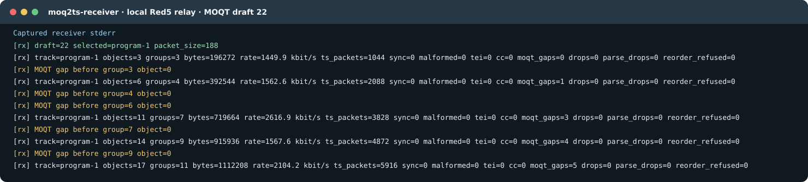

# moq2ts headless CLI (`moq2ts-cli`)

`moq2ts-cli` is a headless MSFTS (MPEG-TS over MOQT) publisher. It reuses the same
streaming core as the GUI but runs under `QCoreApplication`, so it needs **no
display server** and is intended for Linux/server deployment near an encoder.

It reads a **seekable `.ts` file**, a **live stream** (named FIFO or
`/dev/stdin`), or a **live SRT feed**, and publishes `draft-gregoire-moq-msfts`
objects to a MOQT relay.

## Build

Requirements: CMake 3.24+, a C++20 compiler, Qt 6 (or Qt 5) Core/Gui/Widgets, and
pkg-config. `libsrt` is needed for SRT ingest and FFmpeg's libav* for capture and
duration probing; both are found through pkg-config and the build degrades
gracefully if they are absent. The real-relay build additionally needs OpenSSL.

FFmpeg's libavformat loads the GnuTLS build of libsrt (`libsrt-gnutls`), so the
build links that same library when it is installed, and configures moqxr without
its own SRT ingest, which moq2ts does not use. Exactly one libsrt is then loaded:
two copies export the same symbols and crash the process at exit. `ldd
build/moq2ts-cli | grep srt` should list only `libsrt-gnutls`.

On Debian/Ubuntu:

```bash
sudo apt install cmake g++ pkg-config qt6-base-dev libsrt-openssl-dev \
                 libavcodec-dev libavformat-dev libavutil-dev libavdevice-dev \
                 libswresample-dev libswscale-dev libssl-dev
```

The CLI is built alongside the GUI. Two build flavors:

```bash
# Mock build: no relay and no moqxr SDK, accepts only mock:// endpoints.
# Self-contained, so this is the quickest way to check the tree compiles.
cmake -S . -B build-mock -DMOQ2TS_BUILD_WITH_MOCK_MOQXR=ON
cmake --build build-mock -j

# Real relay build: needs the moqxr publisher SDK. Point at either a prebuilt
# SDK directory (containing include/ and lib/*.a) ...
cmake -S . -B build -DMOQXR_SDK_DIR=/path/to/openmoq-publisher-sdk
cmake --build build -j

# ... or a moqxr source checkout, which is built as a subproject.
cmake -S . -B build -DMOQXR_SOURCE_DIR=/path/to/moqxr
cmake --build build -j
```

The real build needs moqxr v0.4.4 or newer and looks for a sibling `../moqxr`
source checkout by default. Set
`MOQXR_SDK_DIR` or `MOQXR_SOURCE_DIR` to use another location. If the selected
moqxr headers are unavailable, configuration fails; a mock build must be
requested explicitly with `MOQ2TS_BUILD_WITH_MOCK_MOQXR=ON`.

Binaries: `build/moq2ts-cli` (real) or `build-mock/moq2ts-cli` (mock).

## Options

| Option | Default | Meaning |
| --- | --- | --- |
| `--endpoint <url>` | `mock://local` | MOQT relay URL (`moqt://` or `https://`); `mock://...` selects local logging and is required in mock builds |
| `--namespace <ns>` | `live/ch1` | MOQT track namespace |
| `--video <path>` | - | TS/M2TS source: seekable file, FIFO, or `/dev/stdin` |
| `--audio <path>` | - | Alternate single-stream TS source path |
| `--srt-config <path>` | - | SRT ingest: JSON caller config (see below). Takes the place of `--video`, and implies `--unmodified` |
| `--camera <id>` / `--mic <id>` | - | Capture device ids (instead of a TS source) |
| `--program <n>` | `0` | Per-program: the MPEG program to carry (0 = first). Unmodified multiplex: the reference program that the catalog names (0 = none) |
| `--unmodified` | off | Unmodified carriage: forward every source packet unchanged (no PID filter or rewrite). The catalog carries the source PAT and PMT as initialization data. The track is `unmodified-program` for a single-program source and `unmodified-multiplex` otherwise; without a PAT the track is refused |
| `--transparent`, `--publish-multiplex` | off | Aliases of `--unmodified`; `--transparent` is kept for existing scripts |
| `--retain-si` | off | Per-program mode: also keep DVB SI PIDs (NIT/SDT/EIT/TDT-TOT). The SDT and the EIT keep the carried service only; the NIT, BAT, TDT, and TOT pass unchanged |
| `--retain-null` | off | Per-program mode: also keep null (0x1FFF) packets |
| `--mux-rate <bps>` | `0` | Advisory stuffing target for `per-program` carriage and a candidate for the MSF `bitrate` field. With 0, a per-program track of a single-program source without `--retain-null` measures the rate from the PCR when the source carries null packets, and a warning says when no rate is declared. MSFTS-02 forbids `mpeg2tsMuxRate` in both unmodified modes; an explicit value there produces a warning and is omitted from that field |
| `--fragment-ms <ms>` | `250` | Object media-duration hint and local mock pacing; RAPs determine media Group boundaries |
| `--segment-bytes <n>` | `65536` | Target object size |
| `--draft <n>` | `22` | MOQT transport draft version: 14, 16, 17, 18, 21, or 22. The relay must list it in `moqt_versions` |
| `--paced` | off | File sources only: pace publishing at media rate instead of as fast as possible |
| `--width/--height/--fps/--video-bitrate` | 1920/1080/30/2500 | Capture params |
| `--sample-rate/--channels/--audio-bitrate/--audio-codec` | 48000/2/160/aac | Audio params |

`Ctrl-C` (SIGINT) or SIGTERM stops gracefully. Exit code 0 on clean completion, 1
on error, 2 on invalid arguments.

## Run: seekable file

```bash
# Per-program carriage (default behavior) with a mux-rate hint.
./build-mock/moq2ts-cli --endpoint mock://local --namespace live/ch1 \
    --video sample.ts --program 1 --mux-rate 38000000

# Unmodified carriage of every source packet.
./build-mock/moq2ts-cli --endpoint mock://local --namespace live/ch1 \
    --unmodified --video sample.ts
```

## Run: live feed over SRT

By default `moq2ts-cli` connects out as an SRT **caller**, so the encoder side
runs an SRT **listener** (the opposite arrangement is under "Listener mode").
Point `--srt-config` at a JSON file in moqxr's format; the first entry in
`srt_callers` is used. `--video` is not needed, the SRT feed is the source.

```json
{
  "srt_callers": [
    {
      "id": "encoder1",
      "srt": {
        "mode": "caller",
        "host": "127.0.0.1",
        "port": 9000,
        "latency_ms": 200,
        "rcvbuf_bytes": 8388608,
        "udp_rcvbuf_bytes": 8388608
      }
    }
  ]
}
```

```bash
# Encoder side: ffmpeg listens for the caller and emits MPEG-TS.
ffmpeg -re -i input.ts -c copy -f mpegts \
  "srt://0.0.0.0:9000?mode=listener&pkt_size=1316" &

# Publisher side: connect, ingest, publish.
./build/moq2ts-cli --endpoint <relay-url> --namespace live/ch1 \
    --srt-config ./srt_callers.json --unmodified
```

`pkt_size=1316` is worth keeping: 1316 = 7 x 188, so each SRT payload holds a
whole number of TS packets and no packet straddles a datagram boundary. The
publisher reads the SRT payloads as one byte stream and passes on whole packets
only, so a sender whose payloads do not end on a packet boundary still works.
`latency_ms` sets SRT's retransmit buffer, which absorbs network jitter on the
ingest side before the publisher ever sees the bytes.

### Listener mode

To have the encoder push the stream to the publisher, set `"mode": "listener"`.
`moq2ts-cli` then binds `host:port` (`host` defaults to `0.0.0.0`, every
interface) and accepts one caller at a time. When that caller disconnects, the
publisher waits for the next one and keeps publishing. The new caller's data
starts a new Group, because its timestamps and PCR need not continue the
previous caller's. The other keys behave as in caller mode.

```json
{
  "srt_callers": [
    {
      "id": "encoder1",
      "srt": { "mode": "listener", "host": "0.0.0.0", "port": 9000, "latency_ms": 200 }
    }
  ]
}
```

```bash
# Encoder side: ffmpeg calls the publisher.
ffmpeg -re -i input.ts -c copy -f mpegts \
  "srt://<publisher-host>:9000?mode=caller&pkt_size=1316"
```

**SRT ingest always uses unmodified carriage** (`--publish-multiplex` says so
explicitly). A contribution feed is forwarded as received, so the per-program
options (`--retain-si`, `--retain-null`) do not apply and are ignored; passing
them prints a warning. The catalog omits `mpeg2tsMuxRate` for either
unmodified mode, but `--mux-rate` remains a candidate for catalog `bitrate`
(see [DEVELOPER.md](DEVELOPER.md)). Use a file or FIFO source if you need
per-program publishing.

A two-program test feed, as used to test this path. ffmpeg encodes both programs
in real time and listens for the publisher on SRT; `-muxrate` pads the multiplex
to a constant rate with null packets, as a contribution encoder does:

```bash
ffmpeg -hide_banner -re \
  -f lavfi -i "testsrc2=s=640x360:r=25" -f lavfi -i "sine=f=440:r=48000" \
  -f lavfi -i "testsrc=s=640x360:r=25"  -f lavfi -i "sine=f=880:r=48000" \
  -map 0:v -map 1:a -map 2:v -map 3:a \
  -c:v libx264 -preset ultrafast -g 50 -keyint_min 50 -sc_threshold 0 \
  -b:v:0 2000k -maxrate:v:0 2000k -bufsize:v:0 2000k \
  -b:v:1 1000k -maxrate:v:1 1000k -bufsize:v:1 1000k \
  -c:a aac -b:a 96k \
  -program program_num=1:title=ProgOne:st=0:st=1 \
  -program program_num=2:title=ProgTwo:st=2:st=3 \
  -muxrate 6000000 -f mpegts "srt://0.0.0.0:9000?mode=listener&pkt_size=1316"
```

`-g 50` at 25 fps gives a random access point every 2 s. MSFTS-02 sets no
maximum Group duration. To check received source packets against the sent feed,
see the end-to-end test in [tests/srt-mpts-e2e.sh](../tests/srt-mpts-e2e.sh).

A multi-program feed is published as one `unmodified-multiplex` track:

| | Without `--program` | With `--program N` |
|---|---|---|
| Track name | `mux-1` | `mux-1-pN` |
| `mpeg2tsProgramNumber`, `mpeg2tsPcrPid` | absent | program N and its PCR PID |
| `mpeg2tsRandomAccess` | absent | absent for SRT, whose recovery fallback can resume without a random access point |
| initialization data | the PAT and the PMT of the first program in the PAT | the PAT and the PMT of N |
| a program leaves the PAT | the track goes on | the track ends when N leaves |
| the PAT lists one program | the track ends | the track ends |

The track ends because the draft forbids `unmodified-multiplex` for a
one-program PAT and requires a new track for a new program number. The
initialization data carries the PMT of the reference program (draft "Use of MSF
Initialization Data"). The draft does not say which PMT a multiplex without a
reference program carries. Without `--program`, moq2ts carries the PMT of the
first program in the PAT, as an implementation choice. When that program leaves
the PAT, the next first program takes over and a new catalog carries its PMT.
The initialization data is declared only when that PMT arrived at the start; it
is never added later.

The SRT receive buffer holds about 5 s. While nothing reads it, for example
while the publisher waits for its first subscriber, it keeps the newest media
and drops the oldest. The stream tries to resume at a random access point of the
PID that starts Groups. If none arrives, the safety fallback can resume at a
packet boundary. Either way the gap starts a new Group, never one already in
progress. The packets are not modified to mark it: in the unmodified modes a
discontinuity in the source reaches the subscriber unchanged (draft "PCR and
Timing"). A gap before the first Object is not published at all: the track
starts at the live edge, and the data read before the gap is dropped with a
warning.

## Run: live feed from ffmpeg (server / near-encoder)

### Via a named FIFO

`-y` is required on every ffmpeg command that writes to the FIFO: `mkfifo` has
already created the path, and without it ffmpeg prompts to overwrite and exits.

```bash
mkfifo /tmp/live.ts

# ffmpeg produces a continuous MPEG-TS into the FIFO (test source shown; swap in
# your real input with -i). Unmodified carriage is the byte-faithful path.
ffmpeg -re -y \
  -f lavfi -i "testsrc2=size=1280x720:rate=30" \
  -f lavfi -i "sine=frequency=1000:sample_rate=48000" \
  -c:v libx264 -b:v 4M -c:a aac -b:a 128k \
  -f mpegts -muxrate 6M -pcr_period 20 /tmp/live.ts &

./build/moq2ts-cli --endpoint <relay-url> --namespace live/ch1 \
    --unmodified --video /tmp/live.ts
```

### Via a stdin pipe

```bash
ffmpeg -re -f lavfi -i "testsrc2=size=1280x720:rate=30" \
  -f lavfi -i "sine=frequency=1000:sample_rate=48000" \
  -c:v libx264 -b:v 4M -c:a aac -f mpegts -muxrate 6M - \
  | ./build/moq2ts-cli --endpoint <relay-url> --namespace live/ch1 \
        --unmodified --video /dev/stdin
```

## Receive MPEG-TS from a relay

Build the console receiver against an installed moq5 main build with the
`service` and `mpeg2ts` targets enabled. The receiver has a standalone CMake
project and does not need Qt:

```bash
cmake -S src/receive -B build-receiver -DCMAKE_PREFIX_PATH=/path/to/moq5/install
cmake --build build-receiver -j
ctest --test-dir build-receiver --output-on-failure
```

Pass the transport dependency paths used to build moq5 if its exported CMake
package needs them. A moq5 build with picoquic WebTransport enabled may also
need `-DMOQ_BUILD_ADAPTER_PICO_WT=ON`. The root build offers the same receiver
target with `-DMOQ2TS_BUILD_RECEIVER=ON` when the publisher's dependencies are
already available.

```bash
./build-receiver/moq2ts-receiver \
  --url moqt://127.0.0.1:4433 --namespace live/ch1 \
  --out capture.ts --stats-json receive-stats.json --insecure
```

`--insecure` is for local or test relays with an untrusted certificate. The
following is a captured run against a local Red5 relay using a paced TS file:



The stats lines contain cumulative object, Group, byte, and TS packet counts;
`rate` is the received bitrate since the previous line. `sync` counts bad TS
sync bytes, `malformed` counts invalid packet structures, `tei` counts packets
with the transport error indicator set, and `cc` counts per-PID continuity
errors. `moqt_gaps` counts reported delivery gaps; `drops`, `parse_drops`, and
`reorder_refused` are receiver delivery counters. The example received valid
TS packets but reported five MoQT gaps. `--stats-json` writes the final counters
when the receiver exits.

The receiver negotiates draft 22 exactly, reads the MSF catalog, and selects
the only compatible MPEG-TS track or the only unmodified multiplex when several
program tracks exist. Use `--track NAME` to select a particular track. It writes
188-byte TS or 192-byte M2TS source packets unchanged; `--out -` writes binary
packets to stdout. `--duration SECONDS` stops a live capture, and `--fail-on-gap`
returns failure when MOQT loss or packet validation errors are reported.
`https://` URLs use WebTransport when the installed moq5 has that backend.

The once-per-second readout includes checks corresponding to
[ETSI TR 101 290 section 5.2](https://www.etsi.org/deliver/etsi_tr/101200_101299/101290/01.04.01_60/tr_101290v010401p.pdf);
this is a subset of the standard's full monitoring checks.

For a two-program SRT relay check with byte-level source comparison:

```bash
RELAY_URL=moqt://127.0.0.1:4433 \
MOQ2TS_CLI=./build/moq2ts-cli \
MOQ2TS_RECEIVER=./build-receiver/moq2ts-receiver \
tests/srt-mpts-e2e.sh
```

The script reports any MOQT gaps; it requires real media, source-identical
packets, and two decodable program entries. It leaves its capture and logs in
the printed temporary directory.

## Verify byte-faithful passthrough

For a file source with unmodified carriage, the published payload should equal
the input byte-for-byte. The mock publisher logs object metadata and byte counts,
not payload bytes. Use the packetizer fidelity checks in
[`m2ts_packetizer_test.cpp`](../tests/m2ts_packetizer_test.cpp) or the relay and
receiver test in [`srt-mpts-e2e.sh`](../tests/srt-mpts-e2e.sh) to check the actual
bytes. The catalog JSON should contain
`"mpeg2tsMode":"unmodified-program"` when the source PAT lists one program,
and `"mpeg2tsMode":"unmodified-multiplex"` otherwise. Neither contains
`mpeg2tsSiPids`. Both carry the source PAT and PMT in a root `initDataList`:
the one PMT of an `unmodified-program`, and for an `unmodified-multiplex` the
PMT of the program `--program` names or, without it, the PMT of the first
program in the PAT (a moq2ts choice).
An `unmodified-multiplex` catalog names its reference program in
`mpeg2tsProgramNumber` and `mpeg2tsPcrPid` only with `--program`. Neither
unmodified mode contains `mpeg2tsMuxRate`.

In per-program mode the PAT/PMT bootstrap (with the rewritten PAT) is carried the way MSF-01 defines it: the
track gets an `initRef` string, and the bytes live in a root `initDataList` entry
of type `inline`. The older MSF-00 spelling put a base64 `initData` field on the
track itself; catalogs in that shape are still parsed on the receive side, but are
no longer produced.

## Notes

- **Start-up look-ahead.** Before a live track starts, moq2ts may read ahead
  in the source: up to 20,000 packets for the first random access point, and
  up to one second of PCR time to measure the mux rate. On a live source this
  delays the start by up to a few seconds. The packets read are published.

- **Live stream = live catalog.** A non-seekable source (FIFO/stdin) is detected
  automatically and advertised as `isLive: true`; VOD duration probing is skipped
  (it would otherwise open and consume the pipe a second time).
- **Per-program mode over a pipe** works too: the PAT/PMT init scan is buffered and
  replayed so no leading packets are lost. If the source never emits PAT/PMT within
  the first ~4096 packets, per-program init fails with a clear error - use
  `--unmodified` for such feeds.
