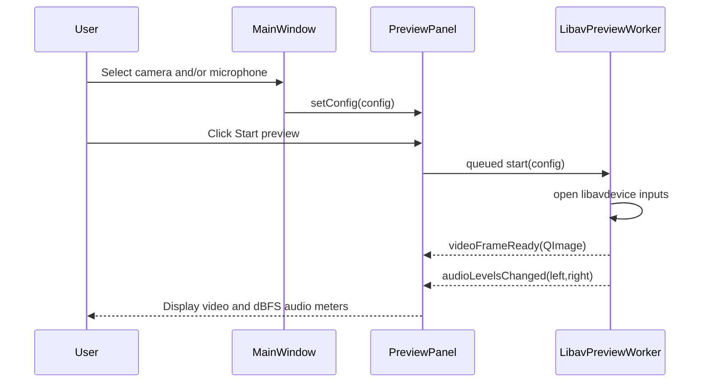
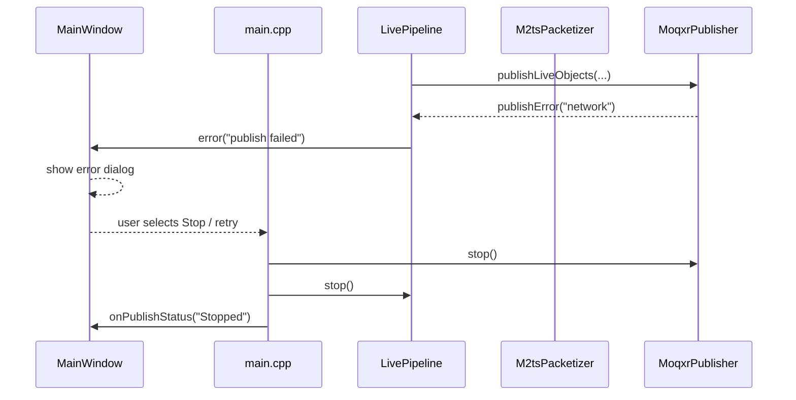
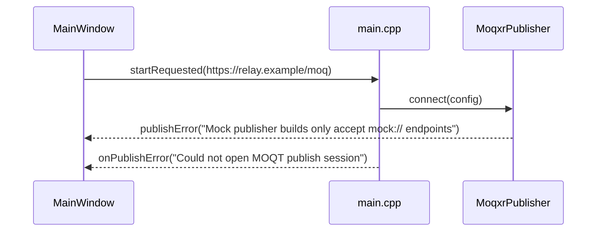
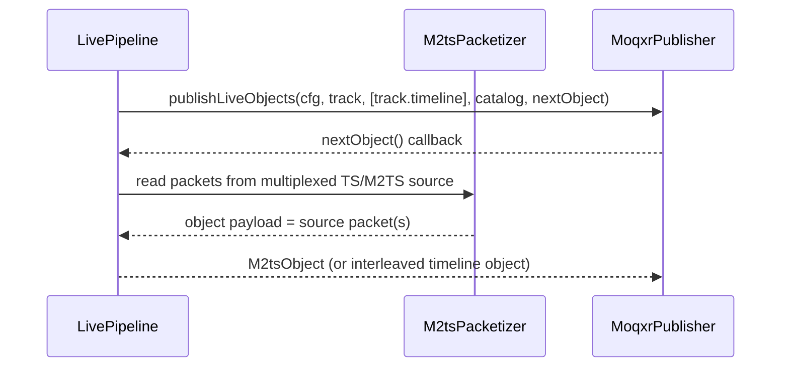
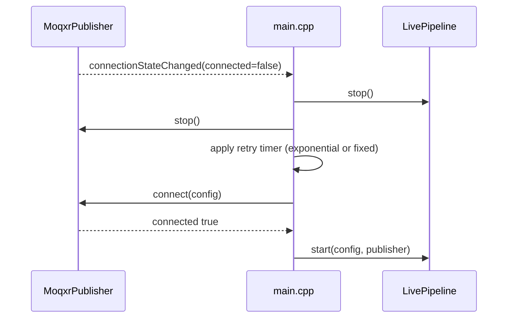

# Sequence Diagrams — MOQ2TS Publisher

## 1) Live publish startup and first Objects

```mermaid
sequenceDiagram
    participant User
    participant UI as MainWindow
    participant Prev as PreviewPanel
    participant App as main.cpp
    participant Pipe as LivePipeline
    participant Pkt as M2tsPacketizer
    participant Mux as MsftsMuxer
    participant Pub as MoqxrPublisher

    User->>UI: Fill endpoint, stream, and source paths
    User->>Prev: Optional Start preview
    Prev-->>UI: Video frame and audio meter updates
    User->>UI: Click Start
    UI->>App: emit startRequested(config)
    App->>Pub: connect(config)
    Pub-->>App: connectionStateChanged(connected=true; configured)
    App->>Pipe: start(config, publisher)
    Pipe->>Pkt: open(programNumber)
    Pkt-->>Pipe: packetSize = 188 or 192
    Pipe->>Mux: catalogJson(MsftsCatalog{mpeg2ts track + .timeline side-track})
    Mux-->>Pipe: catalog JSON
    Pipe->>Pub: publishLiveObjects(cfg, track, [track.timeline], catalog, nextObject)
    Pub-->>Pipe: nextObject() pull
    Pipe->>Pkt: readObject(packetsPerObject)
    Pkt-->>Pipe: whole source packets (M2tsObject)
    Note over Pipe: publish a cumulative .timeline Object per media Group
    Pipe-->>Pub: media or timeline object
    Pub-->>Pipe: framePublished(track, bytes, objects)
    Pipe-->>UI: stats(packets, bytes)
    Pipe-->>Prev: previewVideoFrame / previewAudioLevels
    Pipe-->>UI: status("running")
```

## 1a) Preflight capture preview



## 2) Error path and fallback



## 2a) Mock build with real relay URL



## 3) Media track handling



## 4) Reconnect strategy (proposed extension)


